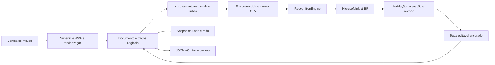

> Documento histórico de uma revisão anterior. Consulte a [arquitetura atual](ENGINE.md) e o [mapa da documentação](README.md) para o estado vigente.

# Decisão e plano do protótipo

Atualização atual: [tipografia por linha e fronteiras de revisão](ANALISE_VIDEO_204054.md). Reconhecer regiões e compor texto passam a ser etapas separadas: fonte sem escalas por palavra, modos de linhas/âncoras, janela de revisão explícita e anotações `InkOnly`. Essa decisão substitui o encaixe individual no retângulo de cada palavra descrito historicamente abaixo.

Atualização de fluidez: [espera adaptativa, snapshots e persistência assíncrona](FLUIDEZ_E_ESTABILIDADE.md) substituem a política inicial de reconhecimento após cada pen-up. O histórico agora copia metadados/listas sem serializar pontos, compartilhando traços concluídos sob contrato de imutabilidade. O reconhecimento recebe apenas a lista da região; autosave serializa no worker. Resultados aguardam estabilidade fora de contato ativo e não disparam nova inferência da mesma revisão. Geometria/bounds são armazenados em cache; coordenadas de cada contato usam transformação fixa. A revisão de diacríticos usa a altura do envelope local para não perder til/cedilha em cursiva.

Atualização de pontuação: `Spatial.Find` agora reúne partes verticais de símbolos compactos e permite pequenos complementos inferiores para cedilha. O adaptador normaliza NFC e resolve apenas a ambiguidade de dois pontos documentada em [pontuação/repertório](PONTUACAO_E_COBERTURA.md); o núcleo não filtra a saída para ASCII nem afirma cobertura de reconhecimento completa.

## Correção após análise do vídeo do usuário

O comportamento inicial descrito abaixo foi revisto em 06/11/2026: uma região não representa mais uma linha inteira. `Spatial.Append` mantém um bloco local ativo, encerra blocos anteriores ao detectar lacuna/mudança de linha e permite pequenos complementos sobrepostos. Margem horizontal é `max(9 DIP, 0,4 × altura estimada)`, com teste de sobreposição vertical. Acentos/complementos são limitados por tamanho, posição e sobreposição; não são gestos de edição.

`TextPlacement.Fit` posiciona os limites reais dos glifos nos limites da tinta original e reduz largura/altura quando necessário. Captura continua em DIPs, e zoom/rolagem apenas transformam a apresentação. Fonte e tamanho são limites tipográficos para conversão automática; edição digitada pode ampliar o bloco. Seleção segue a área local. Não se modifica o texto de outros blocos nem se reprocessa documento antigo automaticamente. O campo persistido `Closed` é aditivo à versão 1; ao abrir, todos os blocos existentes são encerrados.

Caneta não aciona edição por duplo toque durante escrita: contatos rápidos são traços. Mouse mantém duplo clique; ferramenta Selecionar/Editar funciona com ambos. Essa alteração evita que letras/pontos rápidos sejam confundidos com edição.

As seções seguintes registram a arquitetura inicial; a política de região/âncora acima substitui sua política inicial de linha única.

## Evidência anterior ao editor

Compilador .NET Framework 4.x e Microsoft.Ink locais; reconhecedor pt-BR enumerado. A prova de conceito executou A (grupos de palavras), B (componentes geométricos) e C (prefixos de região) sobre os mesmos traços sintéticos. A e C chegaram a `casa`; B produziu `Ca5a`. C emitiu `C`, `ca`, `cas`, `casa`; um traço inicialmente `L` tornou-se `i` ao acrescentar ponto. O laço cursivo sintético não constitui transcrição humana rotulada e não valida cursiva.

Escolha provisória: **C com reprocessamento de região**, pois o motor instalado demonstrou revisão de prefixos, enquanto forçar componentes degradou este exemplo. Não implica superioridade estatística, nem segmentação real por caractere. A/B continuam no experimento reproduzível. Primeira chamada fria não é comparável às chamadas aquecidas; medir ordem aleatória e múltiplos usuários antes de otimizar.

## Componentes e fluxo

Não criar quinze serviços vazios. Captura/renderização ficam na superfície; dados, análise espacial, histórico e persistência no núcleo sem WPF; adaptador de reconhecimento separado; scheduler isolado em thread STA. A interface do motor admite traços e idioma, retornando texto/alternativas sem confiança inventada. Contexto linguístico, alinhamento e configuração avançada são extensões futuras, não campos alegadamente usados pelo Windows.

## Dados e preparação

Documento/página/camada/região/traço identificados. Pontos originais: x/y em DIPs da superfície, tempo de recepção por lote, pressão e inclinação quando o dispositivo expõe. Não há timestamp individual do hardware disponível pelo caminho WPF usado: pontos do mesmo lote compartilham tempo. Sem remover traços pequenos ou aplicar suavização destrutiva. Adaptador cria representação HIMETRIC temporária; originais não são alterados. Reamostragem/filtros ficam desativados até experimento mostrar ganho. Zoom é transformação de apresentação, não do documento.

## Política incremental

Estado: tinta recebida → elegível → snapshot em processamento → hipótese provisória → nova revisão. Reconhecer ao levantar a caneta, respeitando intervalo mínimo para coalescer trabalho; pausa curta permite rever a região, distância para outra região também dá oportunidade. Nada é enviado durante contato ativo. Uma thread COM trabalha de cada vez; fila guarda só a revisão mais nova por região. Não se interpreta posição de candidato como probabilidade. O resultado é sempre revisável, sem limiar de confiança artificial ou consolidação irreversível.

Snapshot contém documento, página, camada, sessão, região e revisão. Aplicação ocorre no Dispatcher e exige correspondência integral; edição, exclusão, abertura, undo/redo invalidam trabalho. Cancelamento é lógico: chamada COM em curso pode terminar, mas resultado obsoleto é descartado. Ordem/versão e aplicação atômica importam mais que tentar interromper código nativo.

## Espaços e acentos

Agrupador experimental usa lacunas horizontais normalizadas pela altura mediana de traços maiores e espaçamento local. Traços sobrepostos permanecem agrupados, incluindo pontos/acento tardios. É heurística, não probabilidade calibrada; não transforma cada traço em letra. Na política C, **o texto e os espaços vêm do motor sequencial**; a geometria organiza regiões e fornece a comparação A/B. Não se sobrescrevem espaços com dicionário. Um classificador de fronteira treinado e fusão motor/geometria exigem corpus rotulado; mecanismo independente de espaços ainda não validado.

## Layout, edição, histórico e disco

Âncora definida no início da região. Texto mantém essa âncora e não causa reflow da folha sob a caneta. Traços originais permanecem associados; novas marcas ficam visíveis até nova hipótese. Duplo clique abre edição tipográfica; edição manual bloqueia revisão automática daquela região. Seleção explícita e exclusão evitam confundir `o`/`l` com gestos. Risco, círculo, inserção por pressão e espaçamento por gesto precisam de contexto e dados: planejados, não ativados por semelhança isolada.

Histórico de snapshots: adicionar tinta, converter, editar e apagar são reversíveis; redo restaura resultado sem reconhecer novamente. Undo/redo invalidam sessão; restauração de tinta suspende conversão até nova escrita. Histórico não é persistido entre execuções. JSON versionado inclui tinta/texto/formatação/revisão/âncoras. Grava temporário, flush e replace atômico com `.bak`; autosave local permite recuperação. Tarefas nunca são serializadas; documento salvo é snapshot consistente no thread da UI.

## Etapas verificáveis e metas (não resultados)

1. Prova do motor e A/B/C: executada antes do editor.
2. Núcleo: integridade, tickets, undo/redo e persistência com testes.
3. Superfície: escrita livre, texto automático, fontes, edição e recuperação.
4. Testes de scheduler com motor controlado e smoke test desktop.
5. Validação humana futura: 30 frases pt-BR pareadas nas três políticas, usuários distintos, cursiva e forma, acentos tardios, números/termos técnicos. Coletar ground truth e ordem contrabalanceada, reportar CER/WER e erros de acento/espaço, taxa de revisões incorretas.

Metas iniciais: renderização p95 <16,7 ms; primeira hipótese p95 <500 ms após pen-up; estabilidade p95 <1 s após último traço; zero aplicações obsoletas em testes; recuperação exata de todos os pontos; CER ≤10% / WER ≤25% no corpus futuro; fronteiras de espaço F1 ≥0,95. Medir CPU/memória e tempo de correções em escrita contínua de 10 min. Nenhuma dessas metas equivale a promessa alcançada.
